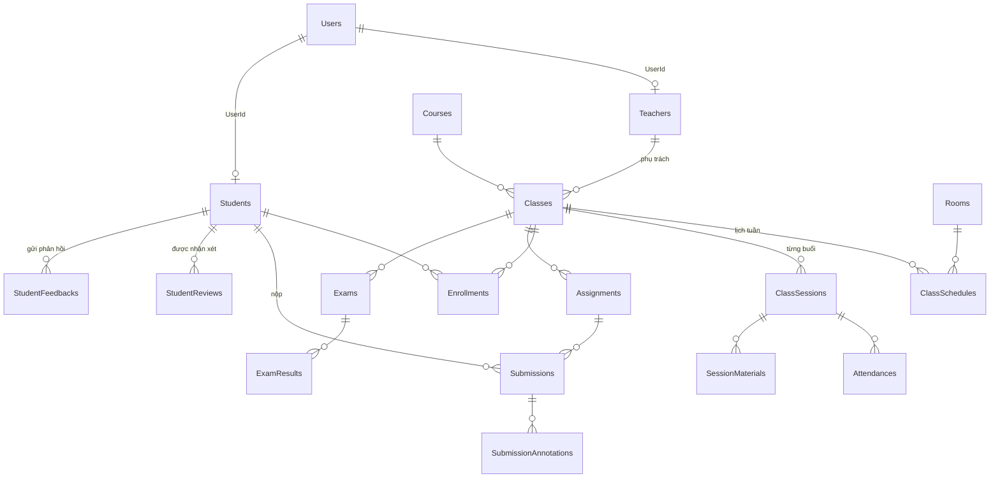

# Database — nằm ở đâu, gồm những gì

> Cập nhật 08/11/2026. Dự án dùng **EF Core Code-First**: bảng được định nghĩa bằng class C#, EF sinh migration, migration tạo bảng trong SQL Server.
> Muốn đổi bảng: sửa **Entity + cấu hình DbContext** → tạo **migration** (chỉ 1 người) → `dotnet ef database update`. Không tạo bảng bằng tay trong SSMS.

## 1. Năm chỗ cần biết (đi từ code xuống ổ đĩa)

| # | Ở đâu | Là gì |
|---|---|---|
| 1 | `app/backend/EnglishCenter.Api/EnglishCenter.Api/appsettings.json` → `ConnectionStrings:Default` | Chuỗi kết nối: `Server=localhost;Database=EnglishCenterDb;Trusted_Connection=True;TrustServerCertificate=True;` (đăng nhập bằng tài khoản Windows) |
| 2 | `.../Entities/*.cs` | **Mỗi class = một bảng**, mỗi property = một cột (vd. `Submission.cs` → bảng `Submissions`) |
| 3 | `.../Data/AppDbContext.cs` (+ `AppDbContext.Teacher.cs`, `AppDbContext.Student.cs`) | Danh sách bảng (`DbSet<...>`) và luật: độ dài cột, khóa ngoại, index, CHECK. Chia 3 file theo vùng để đỡ xung đột |
| 4 | `.../Migrations/` | Lịch sử thay đổi schema. `AppDbContextModelSnapshot.cs` = ảnh chụp schema hiện tại. Bảng `__EFMigrationsHistory` trong DB ghi migration nào đã chạy |
| 5 | SQL Server trên máy (instance `MSSQLSERVER`, SQL Server 2025) | File dữ liệu thật: `C:\Program Files\Microsoft SQL Server\MSSQL17.MSSQLSERVER\MSSQL\DATA\EnglishCenterDb.mdf` + `.ldf`. **Mỗi máy một DB riêng**, không commit file này |

Ngoài ra:
- `.../Data/DbSeeder.cs`, `TeacherSeeder.cs`: dữ liệu demo (5 tài khoản, khóa học, lớp…), chỉ chạy khi `--Database:InitializeOnStartup=true`.
- `tools/db/EnglishCenterDb.bak`: bản backup DB nhóm (chỉ có 12 bảng gốc). `restore-db.ps1` khôi phục, `teacher-features.ps1` áp migration + seed.
- `docs/admin/sql/*.sql`: script sửa tay của Admin/Student (TokenVersion, seed test, StudentFeedbacks). Bảng `StudentFeedbacks` nay **đã có trong migration**, không cần chạy script đó nữa.
- File upload (tài liệu, bài nộp, ghi âm, ảnh đại diện) **không** lưu trong DB: lưu ở thư mục `wwwroot/uploads/...` của backend, DB chỉ lưu đường dẫn `/uploads/...`.

## 2. Migration hiện có (theo thứ tự)

| Migration | Nội dung |
|---|---|
| `20261019064930_InitialCreate` | 12 bảng gốc: Users, Teachers, Students, Courses, Rooms, Classes, ClassSchedules, Enrollments, Payments, Posts, HomepageImages, CenterSettings |
| `20261102164417_TeacherFeatures` | 22 bảng Teacher (buổi học, điểm danh, bài tập, chấm bài, kiểm tra, nhận xét, yêu cầu, thông báo…) + cột `Students.TargetBand` |
| `20261108140000_StudentFeedbackAndSubmissionFile` | Bảng `StudentFeedbacks` (trang Feedback của Student) + cột `Submissions.AttachmentUrl` (file học viên đính kèm khi nộp bài). Viết `IF NOT EXISTS` nên máy đã chạy script SQL cũ vẫn áp được |

Tổng cộng **35 bảng** (+ `__EFMigrationsHistory`).

## 3. Các bảng theo nhóm chức năng

**Tài khoản & người**
- `Users` (email, mật khẩu BCrypt, `Role` = admin / teacher / student, `TokenVersion`) — 1 user ↔ 1 hồ sơ `Teachers` hoặc `Students` (`UserId`).

**Khóa học & lớp** (Admin tạo)
- `Courses` (khóa: tên, band từ → đến, tổng số buổi, học phí) → `Classes` (lớp cụ thể: khóa, giáo viên, ngày bắt đầu/kết thúc, sĩ số tối đa, link online)
- `ClassSchedules` (lịch tuần: thứ, giờ, `Rooms`) → sinh ra `ClassSessions` (từng buổi có ngày, giáo án, nhật ký)
- `Enrollments` (học viên ghi danh vào lớp, `Status` Active/…) · `Payments` (học phí)

**Giảng dạy** (Teacher)
- `SyllabusLessons` (giáo án theo lớp) · `SessionMaterials` (tài liệu theo buổi — **cho học viên xem/tải**) · `Attendances` (điểm danh từng học viên từng buổi)

**Bài tập & chấm bài**
- `Assignments` (đề, hạn nộp, kỹ năng, file đề) → `AssignmentStudents` (giao riêng cho vài HV) · `AssignmentQuestions` (câu Quiz)
- `Submissions` — **nơi lưu bài học viên nộp**: `Content` (bài viết), `AudioUrl` (bài nói), `AnswersJson` (Quiz), `AttachmentUrl` (file đính kèm), điểm IELTS từng tiêu chí, `OverallBand`, nhận xét, lần nộp (`AttemptNo`)
- `SubmissionAnnotations` (lỗi highlight trên bài) · `CommentTemplates` (nhận xét mẫu)

**Điểm**
- `Exams` → `ExamResults` (kiểm tra định kỳ / giữa kỳ / cuối kỳ) · `GradeConfigs` (trọng số tính điểm tổng kết)

**Nhận xét & phản hồi**
- `StudentReviews` — **giáo viên nhận xét từng học viên** (tháng / giữa khóa / cuối khóa)
- `PromotionRecommendations` (đề xuất lên lớp) · `TeacherRatings` (HV chấm sao GV) · `StudentFeedbacks` (HV gửi phản hồi chữ cho GV/lớp)

**Yêu cầu, lịch 1 kèm 1, thông báo**
- `StudentRequests` (HV xin nghỉ / đổi buổi / đặt 1 kèm 1) · `TeacherAvailabilities` (giờ rảnh GV) → `OneOnOneSessions`
- `TeacherRequests` (GV xin mở lại điểm danh; đơn nghỉ của GV đã bỏ)
- `Notifications` (chuông) · `Announcements` (GV gửi thông báo cho lớp)

**Website**: `Posts` (blog), `HomepageImages`, `CenterSettings`.

## 4. Sơ đồ quan hệ chính

## 5. Xem DB bằng mắt

1. Mở **SQL Server Management Studio (SSMS)** → Server name `localhost` → Authentication: *Windows Authentication* → Connect.
2. *Databases* → `EnglishCenterDb` → *Tables*. Chuột phải bảng → *Select Top 1000 Rows*.
3. Kiểm tra migration đã chạy: `SELECT * FROM __EFMigrationsHistory ORDER BY MigrationId;` — phải có đủ 3 dòng ở mục 2.
4. (Tùy chọn) *Database Diagrams* → *New Database Diagram* → chọn các bảng để xem sơ đồ khóa ngoại.

## 6. Lệnh hay dùng (PowerShell)

| Việc | Thư mục | Lệnh |
|---|---|---|
| Áp migration mới sau khi `git pull` | `app\backend\EnglishCenter.Api\EnglishCenter.Api` | `dotnet ef database update` |
| Kiểm tra code và snapshot khớp nhau | như trên | `dotnet ef migrations has-pending-model-changes` (phải báo *No changes*) |
| Liệt kê migration | như trên | `dotnet ef migrations list` |
| Seed dữ liệu demo | như trên | `dotnet run --launch-profile http -- --Database:InitializeOnStartup=true` |
| Máy chưa có DB | gốc repo | `powershell -ExecutionPolicy Bypass -File tools\db\teacher-features.ps1 -SeedDemo` |
